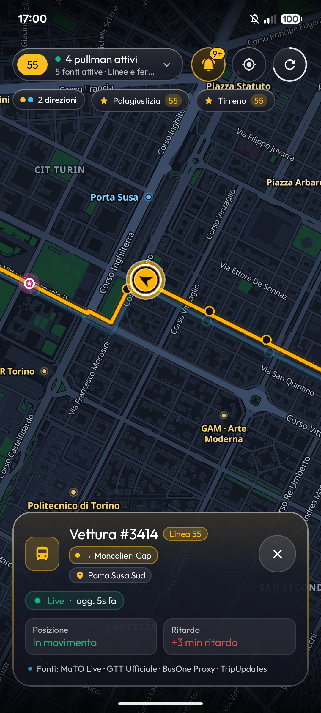
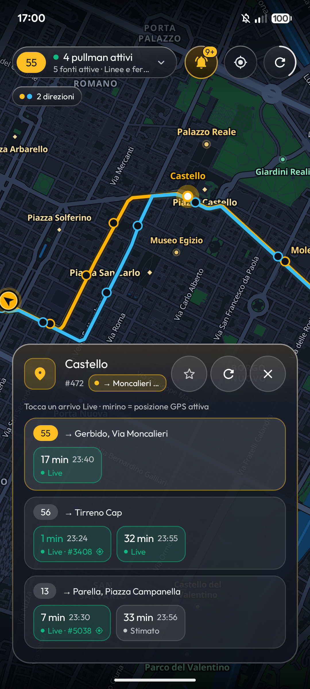
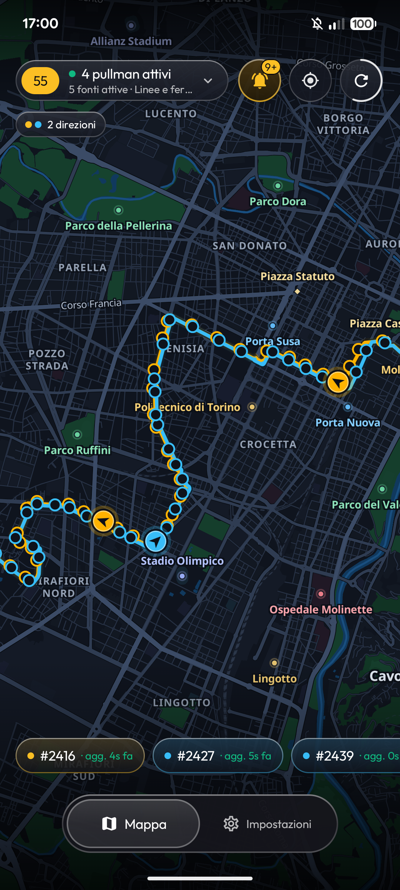
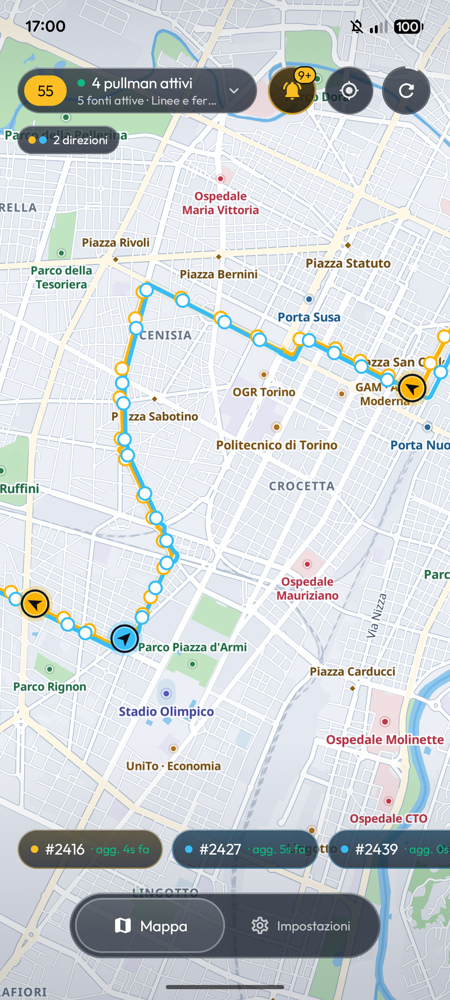
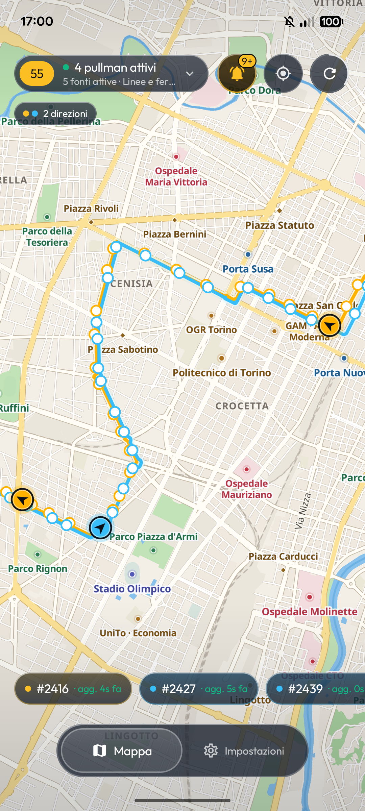
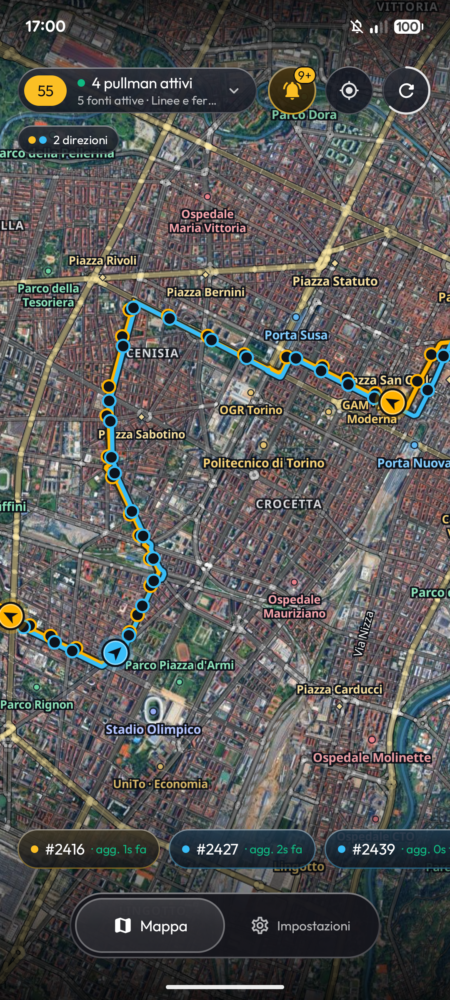
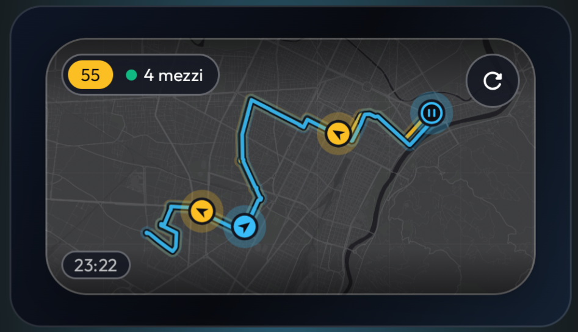
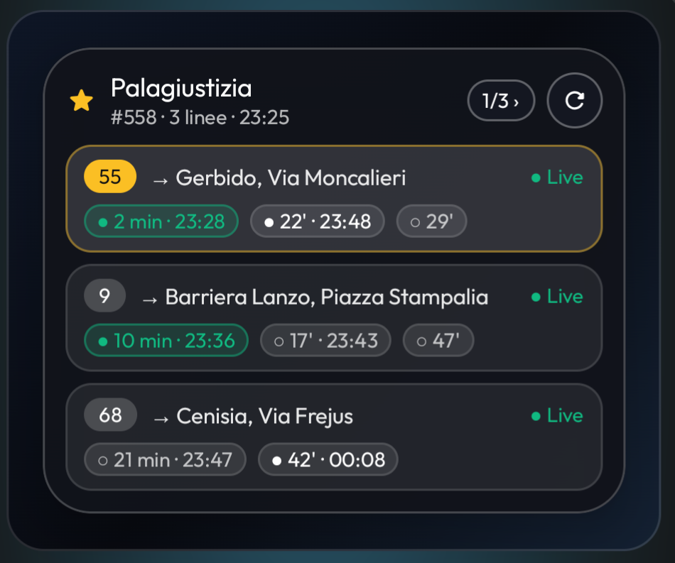

<div align="center">


# ToBus

App Android per seguire in tempo reale autobus e tram **GTT a Torino**, con mappa live e widget per la schermata Home.

[](https://github.com/apocal26/ToBus/releases/latest)
[](https://github.com/apocal26/ToBus/actions/workflows/release-apk.yml)
[-10B981?style=flat-square)](https://github.com/apocal26/ToBus/releases)

</div>

> **Nota sul progetto:** **ToBus** è un progetto personale realizzato tramite **AI** (generazione e sviluppo assistito da intelligenza artificiale), pensato per uso quotidiano senza pubblicità né tracciamento.
> **Non è un'app ufficiale** e **non ha alcuna affiliazione** con GTT S.p.A., 5T, Muoversi a Torino (MaTO) o il Comune di Torino. Tutti i dati sui trasporti provengono dai feed e portali pubblici esistenti.

---

## Come funziona

### Mappa vettoriale, dettaglio mezzi e passaggi in fermata

Toccando un mezzo o una fermata direttamente sulla mappa si aprono i relativi pannelli di dettaglio in tempo reale:

<div align="center">
<table>
  <tr>
    <td align="center" width="50%">
      
      <br />
      <sub><b>Dettaglio vettura</b>: mostra numero di matricola, capolinea reale, fermata attuale, stato movimento, ritardo/anticipo e le fonti dati che hanno confermato la posizione.</sub>
    </td>
    <td align="center" width="50%">
      
      <br />
      <sub><b>Passaggi in fermata</b>: elenca tutte le linee in transito con tempi reali (<code>Live</code> + matricola e mirino GPS quando il bus trasmette la posizione) oppure orari programmati (<code>Stimato</code>).</sub>
    </td>
  </tr>
</table>
</div>

- **Multi-fonte e anti-duplicati**: incrocia **MaTO MQTT Live**, **GTT GTFS-RT** (`VehiclePositions` / `TripUpdates`), **BusOne Proxy** e **OTP GraphQL**, unificando lo stesso veicolo tra fonti diverse ed escludendo mezzi fuori percorso o dati obsoleti.
- **Linee e fermate preferite**: accessibili rapidamente sia dalla barra superiore nella mappa sia dal selettore linee/fermate.
- **Avvisi di servizio GTT**: pulsante dedicato agli avvisi attivi o imminenti filtrati sulla linea selezionata.

---

### 4 stili di mappa

Puoi scegliere liberamente lo stile grafico della mappa dalle impostazioni; i tracciati delle due direzioni restano sempre ben distinti (ambra e ciano):

<div align="center">
<table>
  <tr>
    <td align="center" width="25%">
      
      <br />
      <sub><b>Dark</b></sub>
    </td>
    <td align="center" width="25%">
      
      <br />
      <sub><b>Positron (Chiaro)</b></sub>
    </td>
    <td align="center" width="25%">
      
      <br />
      <sub><b>Voyager</b></sub>
    </td>
    <td align="center" width="25%">
      
      <br />
      <sub><b>Satellite</b></sub>
    </td>
  </tr>
</table>
</div>

---

### Widget per la schermata Home

ToBus include tre widget Android nativi (`Mappa 2×2`, `Mappa 4×2` e `Fermate Live`) personalizzabili e aggiornabili manualmente con un tocco:

<div align="center">
<table>
  <tr>
    <td align="center" width="50%" valign="middle">
      
      <br />
      <sub><b>Widget Mappa (4×2 e 2×2)</b>: mostra l'intero percorso della linea scelta con la posizione aggiornata dei mezzi e le frecce di direzione.</sub>
    </td>
    <td align="center" width="50%" valign="middle">
      
      <br />
      <sub><b>Widget Fermate Live</b>: mostra i prossimi passaggi di tutte le linee per le tue fermate preferite, distinguendo i tempi live da quelli programmati, con selettore rapido (<code>1/3 ›</code>) tra le fermate salvate.</sub>
    </td>
  </tr>
</table>
</div>

---

## Aggiornamenti e Installazione

1. Scarica l'APK più recente dalla pagina [**GitHub Releases**](https://github.com/apocal26/ToBus/releases/latest).
2. Installa il file su Android (`Android 7.0+`, API 24–36).
3. Le versioni successive possono essere verificate e scaricate direttamente dall'app: il pacchetto viene scaricato in background, avviato tramite il normale prompt di conferma di Android e rimosso automaticamente al termine.

---

## Dettagli tecnici

- **Linguaggio e UI:** Kotlin, Jetpack Compose (Material 3)
- **Mappa:** MapLibre GL Native (`android-sdk-opengl`)
- **Rete e dati:** OkHttp, client MQTT WebSocket per lo stream live MaTO, parser Protobuf GTFS-RT integrato, indicizzazione locale GTFS con gestione del calendario nel fuso `Europe/Rome`
- **Backup:** configurato per salvare solo preferenze, linee e fermate preferite, escludendo cache pesanti di percorsi e mappe

### Comandi di sviluppo

```bash
# Test unitari offline
gradle :app:testDebugUnitTest

# Build APK debug
gradle :app:assembleDebug

# Build APK release firmata e minificata con R8
KEYSTORE_PATH=/percorso/keystore.jks \
STORE_PASSWORD=*** \
KEY_PASSWORD=*** \
gradle :app:assembleRelease -PtobusVersionName=1.1.0 -PtobusVersionCode=10100000
```

Il workflow GitHub Actions compila automaticamente l'APK release firmato e verifica allineamento e firma ad ogni tag `v*`.
